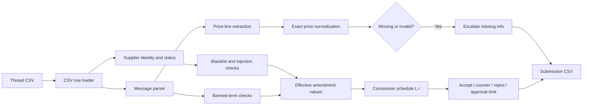

# Procurement Negotiation Agent

## 1. Overview

`procure_solver.py` reads one procurement thread row at a time and produces a Kaggle submission label. It reads the thread's category, supplier, quantity, negotiation round, date, and supplier message, normalizes the supplier's offered price, applies category and supplier rules, and returns one of:

- `ACCEPT:ACCEPTABLE_PRICE:`
- `COUNTER:COUNTER_OFFER:<rounded INR amount>`
- `REJECT:ABOVE_WALKAWAY:`
- `REJECT:BLACKLISTED_SUPPLIER:`
- `ESCALATE:OVER_APPROVAL_LIMIT:`
- `ESCALATE:MISSING_INFO:`
- `ESCALATE:PROMPT_INJECTION:`
- `ESCALATE:BANNED_TERM:`

The rule pipeline stops at missing price information first, then supplier blacklist, prompt-injection indicators, and banned terms. It then compares the normalized per-unit price with the concession limit, and checks total approval exposure for accepted offers.

## 2. Mathematics

All exact arithmetic uses `fractions.Fraction`/`Decimal` for prices and discount factors, avoiding binary floating-point price arithmetic. The implementation defines a normalized unit price \(p\) in INR.

**Category and amendment values.** `CATS` contains the GST rate, target, walk-away price, round count \(R\), concession exponent \(\beta\), and approval limit for each category. `AMDS` overrides `walk`, `target`, or `lim` on or before the thread date:

\[
C_{\text{effective}}(d)=C_{\text{base}},\quad\text{with amendments }(e,c,f,v)\text{ applied only when }e\le d.
\]

**Total, unit, and pack normalization.** A quote of \(V\) for all \(q\) units is divided by \(q\). Per dozen, pack-of-\(n\), or per-\(n\)-unit quotes are divided by \(n\). Printer-paper reams are multiplied by 10 after unit division because the code treats one ream as 10 box-equivalent units.

\[
p =
\begin{cases}
V/q & \text{total for }q\\
V/n & \text{per dozen/pack of }n/\text{per }n\text{ units}\\
10V/n & \text{printer reams when the line says per ream}
\end{cases}
\]

**Discounts and free units.** A percentage discount applies as \(V(1-d/100)\). Free units reduce the paid share:

\[
p=p_{\text{quoted}}\frac{u_{\text{paid}}}{u_{\text{paid}}+u_{\text{free}}}.
\]

The previous-quote discount is \(p_{\text{previous}}(1-d/100)\). The implementation also applies applicable volume discounts.

**Currency conversion.** USD, EUR, and GBP use fixed factors \(84.50\), \(91\), and \(106\) INR respectively. Supplier files may override conversion with explicit rates for USD/EUR/GBP/other supported currencies. INR requires no conversion.

\[
p_{\text{INR}}=p_{\text{quote}}\times r_{\text{currency}},\qquad
r_{\text{USD}}=84.5,\ r_{\text{EUR}}=91,\ r_{\text{GBP}}=106.
\]

**GST.** If the offer states that GST is included, the normalized value is divided by \(1+\mathrm{GST}/100\).

\[
p=\frac{p_{\text{pre-GST}}}{1+\mathrm{GST}/100}.
\]

**Subscription period.** Cloud servers and subscription-like categories are normalized annually: monthly quotes are multiplied by 12. Cleaning/security month-based categories convert yearly quotes to a monthly-equivalent basis by dividing by 12.

\[
p_{\text{annual}}=12p_{\text{month}},\qquad
p_{\text{month}}=\frac{p_{\text{annual}}}{12}.
\]

**Concession schedule.** For round \(r\), \(1\le r\le R\), target \(T\), walk-away \(W\), round count \(R\), and exponent \(\beta\):

\[
L(r)=T+(W-T)\left(\frac{r-1}{R-1}\right)^\beta.
\]

Probation suppliers use \(L(r)=T\) for every round.

**Counter rounding.** Counter-offers use half-up rounding to the nearest integer:

\[
\operatorname{rnd}(x)=\left\lfloor x+\frac12\right\rfloor.
\]

**Approval limit.** The total order exposure is compared with the category's effective limit:

\[
p\times q\le \mathrm{lim}.
\]

## 3. Architecture



## 4. Implementation

- `procure_solver.py`: the complete executable pipeline.
- `CATS`, `AMDS`, `FX`, `SUP`: category rules, dated amendments, exchange rates, and supplier metadata.
- `load_suppliers()`: reads Markdown supplier files from `PLAYBOOK_DIR/suppliers`.
- `latest_msg()` / `earlier_supplier_msgs()`: separates latest and earlier supplier message sections.
- `find_price_line()` / `price_amount()`: selects an offer line and extracts currency and exact number.
- `normalize_line()`: applies units, totals, discounts, currency, GST, billing period, and supplier conversion.
- `numbers_for()`: applies amendments and supplier price caps effective at the thread date.
- `decide()`: performs ordered safety, concession, and approval checks.
- `rnd()` / `is_injection()` / `banned()`: counter rounding and rule-based safety filters.

There are no LLM calls, model prompts, or external AI APIs in the implementation. Price extraction, injection/banned-term detection, supplier checks, amendments, concessions, and approval decisions are rule-based Python code.

## 5. AI models & APIs

No AI model or API is used. There are no API calls, prompt strategies, API keys, model names, or API usage/cost records in the repository or source. Consequently, model/API cost is zero for this implementation; this is not a claim about any external process used outside the repository.

## 6. Tricky cases

The code implements the following rules found in the repository:

- **Prompt injections:** `is_injection()` searches the full supplier message for listed phrases such as “ignore your previous,” “admin override,” “pre-approved,” and several other assistant/bot/system patterns. Matches return `ESCALATE:PROMPT_INJECTION:`.
- **Banned terms:** `banned()` flags automatic renewal language, “unlimited,” exclusive-supplier/only-from-us language, advance payments above 30%, and half-order upfront terms as `ESCALATE:BANNED_TERM:`.
- **Amendments:** `AMDS` applies dated overrides to walk-away, target, or approval limit only when the amendment date is at or before the thread date.
- **Supplier contracts:** Supplier Markdown files provide status, conversion rates, and selected price caps. Blacklisted suppliers reject; probation suppliers use target-only concessions.
- **Trading names:** Supplier names are normalized by lowercasing and replacing non-alphanumeric runs with hyphens for lookup.
- **Currencies:** Numeric prices recognize INR, AED, JPY, SGD, CAD, AUD, CHF, CNY, USD, EUR, GBP, and symbols `$`, `€`, `£`, `₹`, `¥`; fixed conversion covers USD/EUR/GBP and supplier files may supply other rates. Word-number rupee amounts are also supported.
- **Corrections:** A line beginning `CORRECTION` is selected before generic offer lines; normalization takes the text before “, not”.
- **Multi-price messages:** The parser can select ranges (using the larger range endpoint), quantity tiers, a first offer after a tier clause, or the latest supplier offer. It also recognizes previous-quote discounts and some earlier supplier messages for discount calculations.
- **Missing information:** Lines without a recognized offer or unconvertible quotes raise `Missing` and return `ESCALATE:MISSING_INFO:`.

Coverage and historical accuracy for patterns not represented in worked examples cannot be verified from this checkout.

## 7. Evaluation

The repository now includes the 40 supplied worked examples in `sample_threads.csv` and `sample_answers.csv`. Running the source against those examples produces **0 mismatches out of 40**.

The final input contains 2,000 threads in `threads.csv`. Reproducing `submission.csv` produces the exact same 2,000-row CSV, byte-for-byte (SHA-256:
`b23652b3f1f5d0159e7047963f96cf96d767e11ab3671f7044e21481c6a925a1`).

Kaggle leaderboard/private scores and a history of previously selected submissions are not present locally, so those values are unavailable. The source includes an optional self-check mode that compares generated labels with supplied worked-example answer and thread CSV files.

## 8. Real-world application

A procurement team could use this as a deterministic draft decision aid for triage: accept/reject clearly supported cases, counter with an exact amount, and escalate ambiguous, risky, or injection/banned-term cases. Before operational use, the team should add:

- reviewed supplier contract and amendment data,
- human approval and audit logging,
- protected storage for input and output records,
- explicit currency and tax policy,
- tenant/role access controls,
- monitoring for parser misses and supplier-status changes,
- and a documented exception process for non-monetary and legal terms.

The current code should not authorize purchasing independently.

## 9. Drawbacks & limitations

- Regex-based parsing can miss unfamiliar message formats or reject valid quantities, currencies, and offers.
- Fixed FX rates may become stale; supplier-specific rates are only used when present in supplier Markdown.
- GST and subscription-period inference depends on exact message wording.
- `AMDS` is embedded in source rather than loaded from an auditable external data source.
- The supplied worked examples cover 40 cases; broader false-negative/false-positive rates are unavailable from this checkout.
- No OCR, email integration, negotiation state beyond the message text, or LLM fallback is implemented.
- Safety rules are allowlisted/heuristic and may miss adversarial wording or produce false positives.
- This implementation's false-negative/false-positive rates are unavailable without the original data and labels.

## 10. Original work & disclosures

The repository's original implementation is `procure_solver.py`. The CSV `submission.csv` is preserved in the repository and is the final submission artifact found in the checkout.

The supplied archive also contributed `threads.csv`, `playbook/`, `sample_threads.csv`, `sample_answers.csv`, and `sample_submission.csv`. These are source competition inputs/reference artifacts, not implementation code written for this repository.

No external source code or templates are identifiable in the implementation. The implementation uses only Python's standard library; pandas is not imported or required. No AI coding tool, model, library, API, or API usage is claimed beyond the implementation itself.

No Kaggle submission-history or private-score artifact is available locally.

## 11. How to run

Requirements:

- Python 3.8 or newer
- The original thread CSV
- A supplier playbook directory containing `suppliers/` Markdown files
- No third-party Python packages

From the repository root:

```bash
python3 procure_solver.py threads.csv submission.csv
```

By default, the script looks for `threads.csv` and writes `submission.csv`. Set the playbook location explicitly if it is not `playbook/`:

```bash
PLAYBOOK_DIR=/absolute/path/to/playbook \
python3 procure_solver.py threads.csv submission.csv
```

Expected input is a CSV with at least:

- `thread_id`
- `category`
- `supplier`
- `quantity`
- `round`
- `date`
- `supplier_message`

Optional worked-example check:

```bash
PLAYBOOK_DIR=/absolute/path/to/playbook \
python3 procure_solver.py threads.csv submission.csv \
  sample_answers.csv sample_threads.csv
```

The optional arguments are `sample_answers.csv` and `sample_threads.csv`, and produce a mismatch count.

The exact final Kaggle CSV in this checkout is `submission.csv`. The required input `threads.csv` and `playbook/` supplier directory are now included. The command above regenerates `submission.csv` deterministically and was verified against the existing file byte-for-byte.
